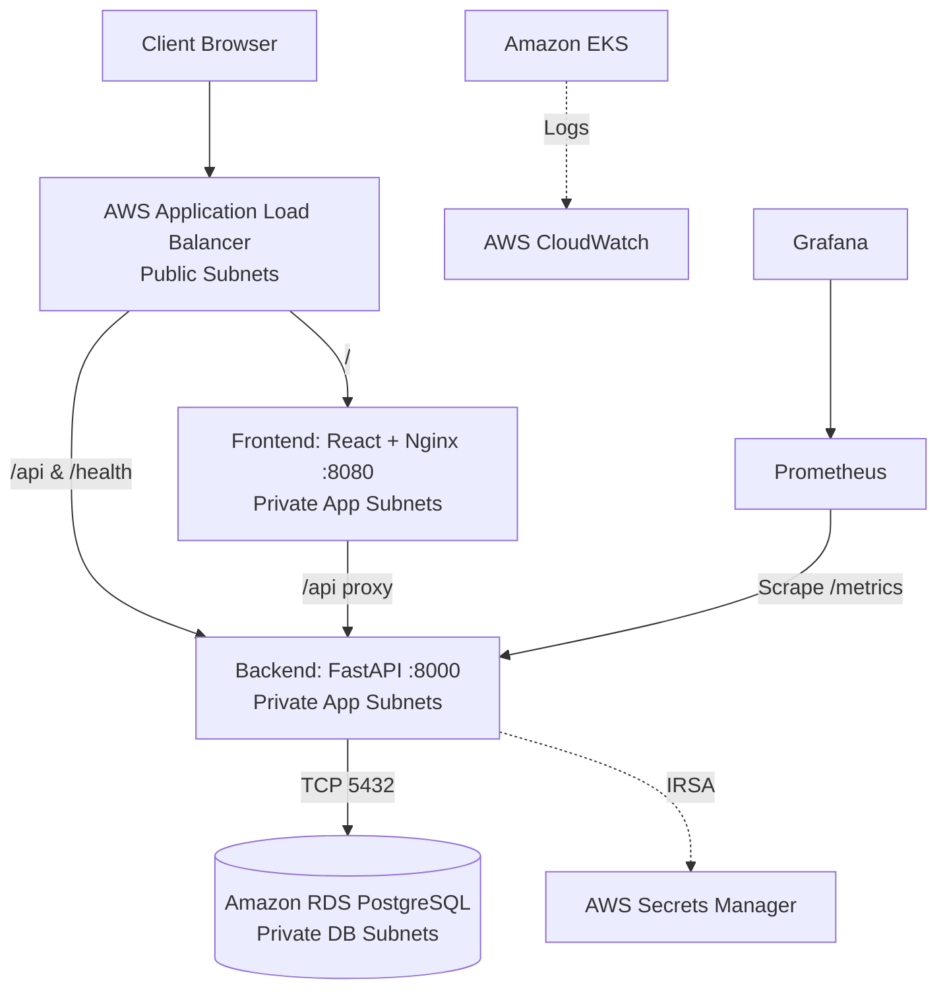

# End-to-End Kubernetes Three-Tier DevSecOps Project

Production-oriented three-tier web platform (**React + Nginx**, **Python FastAPI**, **PostgreSQL / Amazon RDS**) deployed on **Amazon EKS** using **Terraform**, **Helm**, **GitHub Actions (OIDC)**, **Trivy**, **SonarQube**, **Prometheus**, **Grafana**, and **AWS CloudWatch**.

## 1. Project Overview

This repository demonstrates real-world AWS Platform Engineering and DevSecOps practices: modular Infrastructure as Code, multi-stage non-root containers, keyless OIDC CI/CD pipelines, shift-left security scanning, and full-stack observability.

## 2. Business Use Case

Organizations running customer-facing APIs require strict network isolation between public ingress, application compute, and persistent databases, alongside automated vulnerability gates before container images reach production clusters.

## 3. Architecture Diagram



## 4. Technology Stack

| Layer | Technologies |
| :--- | :--- |
| **Frontend** | React 18, Vite, Nginx 1.27 (non-root) |
| **Backend** | Python 3.11, FastAPI, Uvicorn, Pydantic |
| **Database** | PostgreSQL 16 (Amazon RDS in AWS, Docker/SQLite locally) |
| **Infrastructure** | Terraform (VPC, EKS, ECR, RDS, IAM, Security Groups, Secrets Manager) |
| **Orchestration** | Amazon EKS, Kubernetes Manifests, Helm v3, AWS Load Balancer Controller |
| **CI/CD & DevSecOps** | GitHub Actions (OIDC), Trivy (FS & Image), SonarQube, Amazon ECR |
| **Observability** | Prometheus (`ServiceMonitor` & `PrometheusRule`), Grafana, AWS CloudWatch |

## 5. Project Folder Structure

```text
.
├── .github/workflows/      # CI, DevSecOps security scan, and EKS CD workflows
├── application/
│   ├── backend/            # FastAPI service, health probes, /metrics, DB manager
│   └── frontend/           # React SPA + Nginx reverse proxy config
├── docker/                 # Multi-stage non-root Dockerfiles
├── docs/                   # Architecture, deployment, security, troubleshooting guides
├── helm/three-tier-app/    # Parameterized Helm chart
├── kubernetes/             # Raw K8s manifests, ALB Ingress, ExternalSecrets, Monitoring
├── scripts/                # Local validation, build, and AWS cleanup checklist
├── terraform/              # Root IaC + reusable modules (vpc, iam, eks, ecr, rds, sg)
└── tests/                  # Python unit and integration tests
```

## 6. Application Workflow

1. Requests arrive at the **AWS Application Load Balancer** in public subnets.
2. Static UI requests route to **React + Nginx** pods (`:8080`); `/api/*` and `/health/*` route to **FastAPI** pods (`:8000`).
3. FastAPI validates payloads with Pydantic, persists tasks in **PostgreSQL / Amazon RDS** (`:5432`), and exposes `/metrics` for Prometheus.

## 7. CI/CD Workflow

```mermaid
flowchart LR
    Dev[Developer Push] --> GH[GitHub master]
    GH --> CI[Code Validation & Unit Tests]
    CI --> Sonar[SonarQube Analysis]
    Sonar --> TrivyFS[Trivy FS & IaC Scan]
    TrivyFS --> Build[Docker Build]
    Build --> TrivyImg[Trivy Image Scan Gate]
    TrivyImg --> ECR[Push to Amazon ECR via OIDC]
    ECR --> Helm[Helm Upgrade on Amazon EKS]
    Helm --> ALB[Live via ALB]
```



## 8. Security Architecture

- **GitHub OIDC**: Keyless `sts:AssumeRoleWithWebIdentity` trust scoped to `makeiteasymarshal/End-to-End-Kubernetes-Three-Tier-DevSecOps-Project`.
- **Secrets Management**: RDS credentials generated via `random_password`, stored in **AWS Secrets Manager**, and synced via **External Secrets Operator**.
- **Pod Security**: Restricted namespace policy, non-root UIDs, `allowPrivilegeEscalation: false`, and dropped Linux capabilities.
- **Image Security**: Immutable ECR tags, ECR scan-on-push, and Trivy `CRITICAL` vulnerability gates.

See [docs/security.md](docs/security.md) for full details.

## 9. Terraform Deployment Instructions

```bash
cd terraform
cp terraform.tfvars.example terraform.tfvars
terraform init
terraform fmt -check -recursive
terraform validate
terraform plan -out=tfplan
# terraform apply tfplan   # Run only when ready to provision billable AWS resources
```

## 10. EKS Deployment Instructions

```bash
aws eks update-kubeconfig --region us-east-1 --name three-tier-devsecops-dev-eks
helm lint helm/three-tier-app
helm upgrade --install three-tier-app ./helm/three-tier-app --namespace three-tier-app --create-namespace
```

## 11. Monitoring Instructions

- **Prometheus**: Deploy `kube-prometheus-stack` and apply `kubernetes/monitoring/prometheus-servicemonitor.yaml` to scrape `/metrics` every 15s and evaluate `BackendDatabaseDisconnected` / `BackendHighErrorRate` alerts.
- **Grafana**: Apply `kubernetes/monitoring/grafana-dashboard-configmap.yaml` (auto-discovered via label `grafana_dashboard: "1"`).
- **CloudWatch**: EKS control plane logs (`api`, `audit`, `authenticator`) stream to `/aws/eks/<cluster>/cluster` with 7-day retention.

## 12. Troubleshooting Guide

See [docs/troubleshooting.md](docs/troubleshooting.md) for pod readiness, ALB Ingress, and OIDC troubleshooting steps.

## 13. Cost Optimization

- **Single NAT Gateway** in `dev` (`enable_nat_gateway = true`) instead of per-AZ NAT Gateways.
- **ECR Lifecycle Policy** expires images beyond the latest 10 tags.
- **CloudWatch Log Retention** capped at 7 days.
- **RDS `db.t3.micro`** single-AZ with `gp3` storage for practice environments.

## 14. Cleanup Instructions

Follow [scripts/cleanup-checklist.md](scripts/cleanup-checklist.md) in reverse order (`helm uninstall` -> verify ALB deletion -> empty ECR -> `terraform destroy`) to prevent orphaned billable resources.
