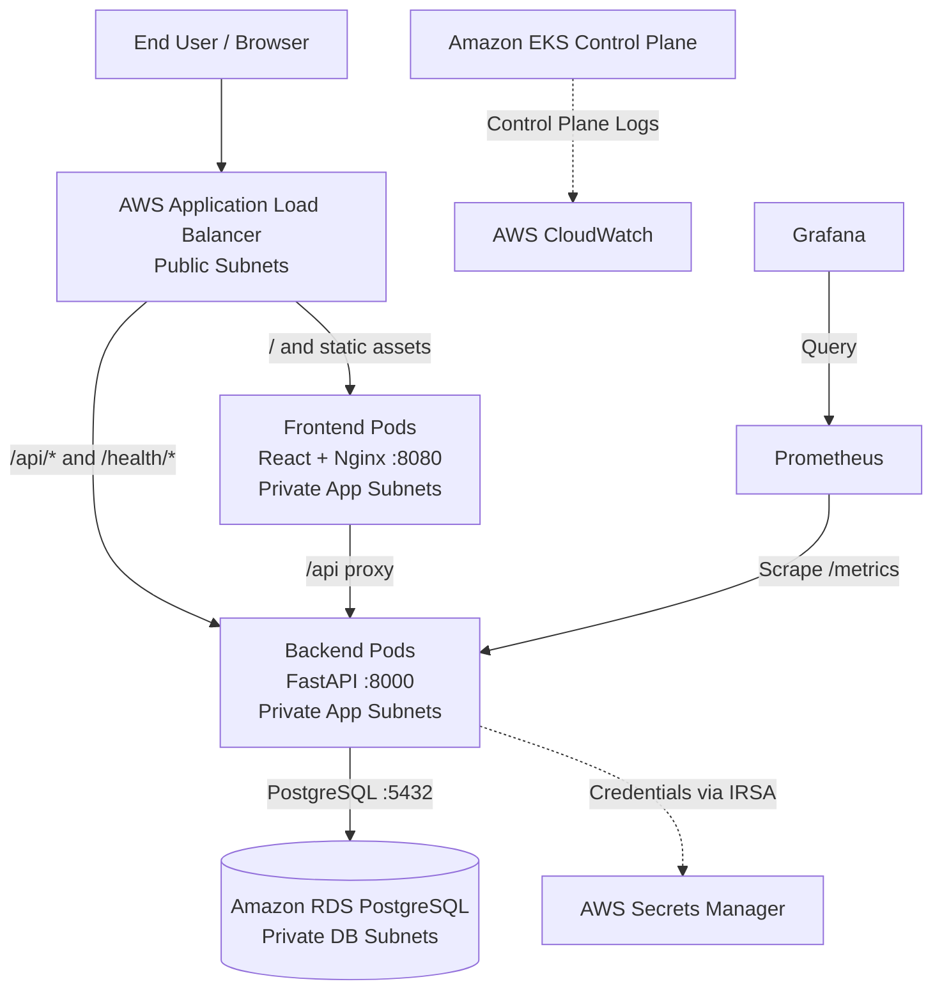

# Architecture Overview

## Three-Tier AWS & Kubernetes Architecture

## Network Segmentation

1. **Public Subnets (`10.0.1.0/24`, `10.0.2.0/24`)**: Host the internet-facing AWS Application Load Balancer and NAT Gateway.
2. **Private Application Subnets (`10.0.11.0/24`, `10.0.12.0/24`)**: Host Amazon EKS worker nodes and application pods (React/Nginx + FastAPI). Outbound internet access routes through the NAT Gateway.
3. **Private Database Subnets (`10.0.21.0/24`, `10.0.22.0/24`)**: Host Amazon RDS PostgreSQL with `publicly_accessible = false` and no internet route.
